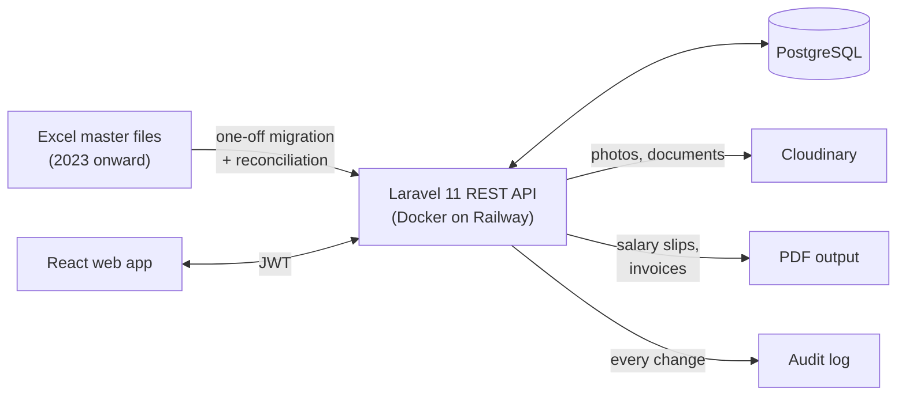

<h1>HR and Operations Platform</h1>

  
  
  
  
  
  
  

<table>
  <tr>
    <td align="center"><b>14</b> modules</td>
    <td align="center"><b>~140</b> API routes</td>
    <td align="center"><b>3 years</b> of Excel history migrated and reconciled</td>
    <td align="center"><b>27</b> data models</td>
    <td align="center"><b>1</b> developer</td>
  </tr>
</table>

An HR, payroll and operations platform I designed and built, as the sole developer, for a manpower
company that supplies staff to oilfield-services clients in Iraq. It replaced a set of Excel master
files and paper slips with one system covering employees, attendance, payroll, invoicing, expenses,
travel and service tickets, documents and profit and loss.

> The source code belongs to the client and the system holds employee and payroll records, so this
> repository holds the write-up only. I am happy to walk through the code on a call.

## At a glance

| | |
|---|---|
| Role | Sole developer: requirements with operations and finance staff, design, build, deployment, support |
| Size | 14 modules, 27 models, 47 migrations, ~140 API routes |
| Backend | Laravel 11 (PHP 8.2), PostgreSQL, JWT auth (tymon/jwt-auth), Spatie Activity Log and Query Builder |
| Documents | DomPDF salary slips and invoices, PhpSpreadsheet imports and exports, Cloudinary + Intervention Image |
| Frontend | React, TanStack Query, React Hook Form + Zod, Radix UI, Recharts, react-pdf, Framer Motion |
| Hosting | Docker image deployed to Railway with PostgreSQL and migrations run on each release |

## Architecture

## Modules

- **Employees:** profiles, bank accounts, department and designation history, rate history, documents
- **Attendance:** monthly attendance per employee and site, feeding payroll directly
- **Payroll:** salary calculation from attendance and the rate in force for that month, advances,
  held salaries, arrears, PDF salary slips and slip payments
- **Invoicing:** client invoices with line items built from the same attendance, partial payments
- **Expenses, air tickets, service tickets:** operational costs tracked per employee and department
- **Profit and loss:** monthly P&L per department, plus partner profit distribution
- **Documents:** uploads to Cloudinary with image processing
- **Users, roles and audit:** JWT role-based access, admin user management, and an activity log of every
  create, update and delete across modules
- **Reports and settings**

## Problems worth talking about

**Three years of history from spreadsheets.** The company had run on monthly master workbooks since
2023, with salary sheets, invoices and P&L in different files and formats. I wrote import scripts for
the real workbooks, loaded the history into PostgreSQL, then produced comparison sheets (system vs.
original sheet) for payslips, gross salary and profit, month by month, until the differences were
explained or fixed. The finance team signed off on numbers they could trace back to their own files.

**Rates that change over time.** Employees move between departments and get rate changes mid-year, and
old payslips must still reproduce exactly. Rates and departments are stored as dated history rows, and
payroll always reads the rate that applied in that month instead of the current one.

**Payroll edge cases as data, not hacks.** Advances, held salaries and arrears are their own records
linked to the slip they affect, so a held salary released three months later shows up correctly on
both slips and in the P&L.

**One source for payroll and invoicing.** The same attendance record drives what the employee is paid
and what the client is billed, so the two can no longer drift apart.

**Accountability.** Every change is written to an audit log with the user and the before and after
values, which matters when salaries and client invoices are involved.

## Contact

Fatima Salahuddin, BS Computer Science, FAST-NUCES Karachi
[Profile](https://github.com/fatima-salahuddin) · [LinkedIn](https://www.linkedin.com/in/fatima-salahuddin-/) · fatimasalahuddinmirza@gmail.com
